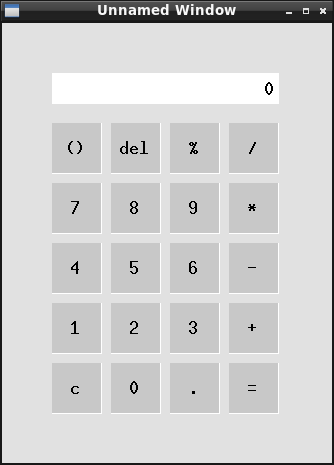
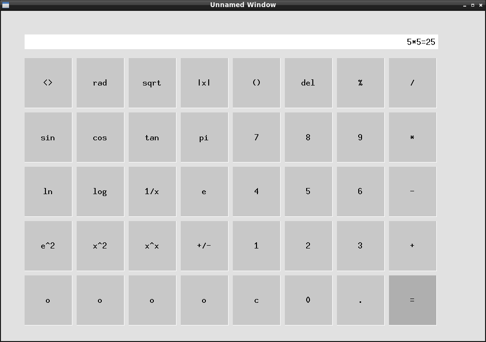

First 'charKeyInput' is now 255 * sizeof()
used to get resized several times without calloc() when removing characters but are commented out.
Might be screen size related.
- charKeyInput = malloc(


-     if (geometryRead[0] == 1) {

-   // 'write()' if the text coordinate is greater than the left most text window boundary.


2.)

    - larger display/history

    - history window (temporarily extend text input window)

if (keyInput == 61 && (intKeyInputIterator < 14 && intKeyInputIterator > 1)) {

FOIL

keyInput -> charKeyInput -> write()

// ASCII 40 and 41 conditional has been met.
if (previousKeyStart == 1) {
  0) evaluate expression in '(' ')'
  1) send answer to the next arithmatic
    i.e. ' (1 + 1) * 3 =
           (2)     * 3 =
                       = 6
}

3.)

    - Click text input window to insert number - the coordinates of the text, the 'keyInputIterator' value for the 'charKeyInput[]'.

- Text input window issues.

      - After calculation, 'del' removes the entire string -> move to the history window

      - Starting '0' is removed when the screen resizes.

  - Remove space button and off button mouse click repeating characters

  - Pressing 'Enter' after the '0' and '1' character elements without '=' or '-' resets the character array.


# calculator

Calculator written using C and without bitwise operators and integer arrays.

Tested on:

RaspberryPi 4b aarch64

Debian GNU/Linux 12 (bookworm)

X.Org X Server 1.21.1.7

X Protocol Version 11, Revision 0

  - X11 is not used in most linux distributions by default and might be discontinued.

Operating system workflow:

1. Install debian or ubuntu server command line (headless - no GUI) from the official imager.

2. Install X11.

Read about the computer:

- https://www.raspberrypi.com/documentation/computers/os.html

- Google: 'university machine organization and assembly class'

- Learn 'C' syntax

Usage (after downloading the folder):

```
gcc main.c ./src/*.c -o calculator200 && ./calculator200
```

Compile specific files by listing:

```
gcc main.c binaryFunctions.c arithmatic.c userInput.c -o binary && ./binary
```

### Todo:

- Math

  - Screen size 1.) non-arithmatic ( ), +-.

  - Binary division.

    - Division -> powers of 2 to reduce iterations and theres another algorithm (Newton-Raphson Division) for larger numbers.

    - Fractions.

    - There are decimals randomly in the char array instead of binary.

  - Screen size 1.) arithmatic buttons i.e. 'sqrt()', exponents, etc.

  - Double check if binary arithmatic can increase from 200 -> 256 otherwise cap at 128. Otherwise arithmatic calculations are from 0-200.

    - Larger numbers are reprsented by small numbers in an array using a maximum size i.e. 256 or 128 and is called arbitrary-precision arithmatic or 'bignum arithmatic'.

    - Internet also calls this 'Horner's method' and uses base-200 for the example:

```
//             250,678 / 200 = 1,253 remainder (%) = 78  (200^0)
//                             1,253 / 200 = 6 (%) = 53  (200^1)
//                                 6 < 200         = 6   (200^2)
//
//                                                 = [ 6, 53, 78] < - the 'char[]' to store the number
//           - Reconstruct:
//                                                   6 X (200^2) = 6  X 40,000 = 240,000
//                                                  53 X (200^1) = 53 X 200    = 10,600
//                                                  78 X (200^0) = 78 X 1      = 78
//                                                                             = 250,678
//
//           - Since division using 200 is a nested loop with longer time complexity, divide by 256 (2^8)
//             where the division step is O(n) since it's a power of two
//
```

  - Technical binary issues

    - fix inputArithmatic variable names with new struct int pointers and malloc.

    - subtraction() and addition() use same function series to convert int to char[] binary.

    - test 'fileLog()' error messages from 'subtraction()' and 'binaryInvert()'.

    - 'serverConnect()' in "window.c" has a bitwise comparison that's mostly in "binaryChar.c".

    - 'multiplication()' in "arithmaticSteps.c"

    ```
      - Probably don't need 'binaryAddCheck' for the if/else since 'intBinaryGreatTwo.three' says
        which one is longer with '0' '1' '2' but the extra int is four extra bytes.

      - 'binaryAddition()' in "arithmatic.c" uses a 'freeCheck' to 'free()' the inputs and the "arithmatic.c".
        functions were changed. The deceased 'binaryAdditionTwo()' used 'free()' on the second input char[] pointer
        since 'struct binaryAdd' is both the input and the output. An 'int' check of '0' '1' '2' '3'
        is used to free in the first 'binaryAddition()', removing 'binaryAdditionTwo()' but doesn't
        reduce heap usage (actually increases stack memory by (4 * the number) of times it's used throughout
        // the entire program (~4-6 times)).
        // might not need to return the length of the char pointer or use a struct at all
        // not sure if the struct is too large since its only a 'int' a 'char pointer', and two blank 'int'.

        //struct threeInt intBinaryGreat = intBinaryCheck(intBinaryOne, intBinaryTwo);
        /////////////////////////////////////////////////////
        // or use the function since 'struct threeInt intBinaryGreatThree' has a blank char[] pointer on heap the entire while loop
        // in addition to 'struct threeInt binaryAdd' which also exists the entire time.
        // 'binaryAdd.string' and either 'zeroStep' or 'oneStep' are the same length
    ```

- GUI issues

  - Text buttons - 'screenCheckZero' and sometimes 'screenCheckOne' multiple characters don't resize with the window.

  - initial screensize '0' and 'eventCode == 12' buttons are off by several coordinates

  - minor todo

    - continuous mouse coordiantes based on event to verify border values.

    - 'errorCode == 12' succeeds within 1 or 2. Should probably use a 'iteration' counter.

    - Google AI suggested this method to reduce memory but would probably crash now since theres several 'write()':

      - Allocate a single large unsigned char buffer, append all the opcodes back-to-back (ensuring each individual opcode is padded to a multiple of 4 bytes), and send them all out using one single write() call. The X11 server will parse them sequentially out of the TCP/Unix stream automatically and is supposedly faster.

- GUI features

  - Change the non-decimal button color and '=' button color

  - Repeating '=' i.e. 2 * 2 = 4    or answer * (n)
                       4 * 2 = 8
                       8 * 2 = 16
                      16 * 2 = 32


  - Replace button polygons with polylines.

    - Rounded corners that increase in size with use to mimic the passage of time.

  - Disable window manager and get the device's screen dimensions.

    - Make an 'x' and minimize button to close the program.

- Other notes

```
1) char *string = "Hello";
   string[0] = "Y"; -> doesn't work since pointer is immutable unlike 'malloc' -> 'strcpy'.
2) char otherString[6] = "Hello"; -> includes space for a null-terminator and can be
   returned from array with 'malloc' -> 'strcpy'.
     - sizeof(otherString) returns the length of the char[].
- Reviewed "binaryChar.c", "arithmatic.c, arithmaticSteps.c, interface.c, userInput.c"
  - line 112 the 2 'charBinary2Int()' functions exist because the first 'struct' has three
    int and one char.
3) 'const' can't be sent from "oneFile.c" to use another function from "twoFile.c" unless
   the 'const' is set as another variable with 'malloc()' or 'while{}' even if it's a
   pointer. The other function has to already accept a 'const' which limits basic
   functions from "utility.c".
4) 20260726 - 'char' pointer with 'malloc()' doesn't need 'strcpy(dest, "a")' unlike
              previous versions. It also doesn't fill the array with duplicate "a" the
              length of the 'malloc()' 'char' pointer since 'memset()' suddenly exists.
            - 'charAppend()' in "utility.c" 'strcpy()' was commented out but it might break stuff later.
```

### Index

- *Binary arithmatic*

- *Text user interface*

- *Graphical user interface (GUI)*

### Features:

- *Binary arithmatic*

  - Depends on built-in C headers:

        ```
        #include <stdio.h>
        #include <string.h>
        #include <stdlib.h>
        ```

  - Mostly uses 'char[]' arrays (1 byte) instead of 'int' arrays (4 bytes).

    - I was learning C and didn't understand heap vs stack memory so there are a lot of 'malloc()' uses. I'm guessing the fastest is one giant C file without functions.

    - Decimal limit is ~200 without a loop and is similar to computer hardware while avoiding electrical fires.

  - ```./src/arithmatic.c```

    - Binary addition and utility functions for subtraction and multiplication.

  - ```./src/binaryChar.c```

    - Converts decimal 'int' to binary 'int' and back to decimal for the interfaces.

  - ```./src/arithmaticSteps.c```

    - Runs binary addition, subtraction, and multiplication (Todo - division).

    - 'window.c' utilizes an abbreviated division that rounds numbers (GUI section).

- *Text user interface*

    ```

    Enter two numbers less than 200
    with arithmatic operators
    +  ,  -  ,  *  ,  /  ,  **

    Example: 1 + 1 (press enter):

    _____________________________

    ```

  - ```./src/userInput.c```

    - Formats user input and writes to a '.log' file.

    - Used in "interface.c" 'textGUI()'.

  - ```./src/interface.c```

    - Runs the functions from 'userInput.c'.

- *Graphical user interface (GUI)*

  - Works on Linux X11 server.

  - Written without the X11 library. Information from Google AI to avoid documentation.

  - 'write()' and 'read()' functions from '/sys' folder to make a window.

        ```
        // Set two structs and several variables
        // https://www.man7.org/linux/man-pages/man7/unix.7.html
        // used in "server.c" and "client.c" for window.
        #include <sys/socket.h>
        #include <sys/un.h>
        // ./usr/include/unistd.h
        #include <unistd.h>
        ```

  - ```./src/window.c```

    - After connecting to the server, the packets are specified in several thousand lines 'drawWindow()'.

    - 'char[]' array elements have an integer limit of 255.

      - The workaround for X11 Server packets is 2-4 low/high packets to represent the entire range of C integers for 64 bit OS (~ 4 billion). For example:

            ```
            Little-endian (no spell check joke) byte-ordering allows larger
            numbers with four 1-byte elements representing a 32 bit integer.

             char  example[32];

                   example  [28] 128               =  128     +
                   example  [29] 62 ( * 256)       =  15872   +
                   example  [30] 0  ( * 65536)     =  ( 0 ) ) +
                   example  [31] 0  ( * 16777216)  =  ( 0 ) )

            ```

      - The main challenge is a continuous 'while' loop that waits for feedback from the server.

        - There are three long code duplicates for button drawing that would be more readable with functions. However, functions were avoided to save heap memory:

          - The initial window before the continuous 'while' feedback.

          - 'eventCode==12' (window has to be redrawn including the buttons).

          - 'eventCode==22' (window is resizing).

  - Three screen sizes that mimic smartphone, tablet, desktop device orientation.

  - Resizes buttons using powers of 2 division to reduce nested loops.

  - Since the desktop view (dubbed 2.)) is undecided, the obvious answer is to make a map.

    - Requires polylines to draw the features.

    - Would have to download CSV coordinates for basic features.

      - GeoJSON file parser.

      - Reverse engineer the JPG and shapefiles for the basemap.

      - X11 is not used in most linux by default anymore and might be discontinued.

      - 'Google Maps v 8billion' should probably a different project.

  - The button layout schematics are from the './src/window.c' file:

    ```
      // To resize with the window size, use the dimensions of the window to change the button dimension
      // values in step 6 to redraw the butons. The most efficient method is having three predesignated layouts
      // and resize. The default window dimensions are below.
      //
      //  s = screen text input -> opcode 76 (imageText8) write text -> opcode 45 (openFont) resize -> fontid
      //     - text box accepts things like 'sqrt()' and other common inputs
      //
      //   ~~~~~~~~~~~~~~~~~~~~~~~~~~~~~~
      //  {                              }                                 20  <> = switch buttons
      //   ______________                }  0.) 4 X 5 = 20     1.) 8 X 5 = 40   o = scientific
      //   -----         ]               }     -------------      _____________________________________
      //  |     |        ]               }    | s s s s s s |    [                                      ]
      //  |     |        ]               }    | s s s s s s |    [ s s s s s s s s s s s s s s s s s s  ]
      //  | 0.) |        ]               }    |             |    [ s s s s s s s s s s s s s s s s s s  ]
      //   -----         ]               }    |() del %  /  |    [ s s s s s s s s s s s s s s s s s s  ]
      //  [              ]               }    | 7  8  9  *  |    [                                      ]
      //  [              ]               }    | 4  5  6  -  |    [ <>  rad  sqrt  |x|  ()  del   %    / ]
      //  [      1.)     ]               }    | 1  2  3  +  |    [                                      ]
      //  [ ____________ ]               }    | c  0  .  =  |    [ sin  cos  tan  pi   7    8    9    * ]
      //  {                              }     -------------     [                                      ]
      //  {                              }                       [ ln   log  1/x  e    4    5    6    - ]
      //  {                              }                       [                                      ]
      //  {                    todo 2.)  }                       [ e^2  x^2  x^x  +/-  1    2    3    + ]
      //   ~~~~~~~~~~~~~~~~~~~~~~~~~~~~~~                        [                                      ]
      //                                                         [ o    o    o    o    c    0    .    = ]
      //                                                         [ ____________________________________ ]
      //
    ```

- Screensize 0.)



- Screensize 1.)



  - Button input explanation 'eventCode == 4' and 'eventCode == 6'.

    ```
      // char limits int to 255 and this method overflows into two char elements which uses multiplication to achieve
      // larger numbers (i.e. the mouse click input responseWindowInput[24] and [25]). To find the bottom border for the
      // button, the larger input '[25]' is compared using greater than or equal '>=' to the previously calculated array
      // 'buttonBorder[j][13]' that contains the larger bottom 'x' coordinate border. The larger number is the second
      // element in the two char array elements used to represent larger int numbers and are refered to as 'x2' or 'y2' in
      // contrast with the first element 'x1' or 'y1'. The equation is ((x1 * 256^0) + (x2 * 256^1)...etc). If the 'x2' input
      // (responseWindowInput[25]) is '>=' to the comparison (buttonBorder[j][13]), 'x2LowCheck' passes and proceeds to the
      // next check for 'x1LowCheck'.
      //
      // The 'x1' 'x2' 'low' and 'high' values are difficult to visualize and a diagram is included:
      //
      //          y1y2 low
      //          ________
      //     x1  |        |  x1
      //     x2  |        |  x2
      //    low  |        |  high
      //         |________|
      //          y1y2 high
      //
      // Summary: -'x1x2 low' represents one number.
      //
      //      x1   = 55    =   ( 55  X  256^0 )       x1 = 55
      //      x2   = 0     =   ( 0   X  256^1 )       x2 =  0
      //                                               x =  55    ( 55 + 0 )
      //
      //      y1   = 100   =   ( 100 X  256^0 )       y1 =   100
      //      y2   = 1     =   ( 1   X  256^1 )       y2 =   256
      //                                               y =   356   ( 100 + 256 )
      //
      //          - The standard graph (not flipped) with a point.
      //
      //  400   _|
      //  300   _|     * (x,y)
      //  200   _|
      //  100   _|
      //    0   _|___________
      //         |    |    |
      //        0    50   100
      //
      //          - Coordinates are an upside down graph for y and usual left to right x direction.
      //
      //        0    50   100
      //    0   _|____|____|__
      //  100   _|
      //  200   _|
      //  300   _|
      //  400   _|     * (x,y)
      //
      //         - The coordinates represent a polyline boundary.
      //
      //        0    50   100
      //    0   _|____|____|__
      //  100   _|     |
      //  200   _|     | x = 55
      //  300   _|     |
      //  400   _| ----|-------
      //             y = 356


      Example conditional (there are (4 X 2) for each side of the button):


        // x2 low boundary
        if (responseWindowInput[25] >= buttonBorderOne[j][13]) {
          x2LowCheck = 1;

          // The next comparison splits based on if the larger 'x2' number is '==' or '>'. The first 'if' has another
          // condition for the 'x1' value which asks if the mouse click input 'responseWindowInput[24]' is '>=' the
          // 'buttonBorder[j][12]' 'x1' border. If both those conditions are true, 'x1Lowcheck' is set to '1'. If they're
          // not, the second split asks if only the 'x2' is '>' 'buttonBorder[j][13]' and sets 'x1LowCheck' to '1'. Otherwise
          // 'x1LowCheck' remains '0' and a 'break;' would probably work to reduce further iterations.

          if (responseWindowInput[25] == buttonBorderOne[j][13] && responseWindowInput[24] >= buttonBorderOne[j][12]) {
            x1LowCheck = 1;
          }
          else if (responseWindowInput[25] > buttonBorderOne[j][13]) {
            x1LowCheck = 1;
          }
        }


      //
      // x low  = 55
      // x high = 105
      // y low  = 356
      // y high = 506
      //     +  = button clickable area
      //
      //        0    50   100   ...n
      //    0   _|_____|_____|_______
      //  100   _|      |    |
      //  200   _| xlow |    | x high
      //  300   _|      |    |
      //  400   _| -----|----|----
      //         |      |++++| y low
      //         |      |++++|
      //  ...n   | -----|----|----
      //                 y high
      //
      // Clicking the button returns '0-9' or the other calculator inputs.
    ```

- Data structures and algorithms 'window.c'.

    ```
      // Intermediate screen size 1.) implementation:
      //
      // Change button background when hovered 'eventCode == 6'.
      // Decreased button redrawing from all 40 to +-8 and improved user experience.
      // Three character arrays of different sizes:
      //     Dimensions of the previous button  -  buttonTextOne[40]
      //                         words > 1 char  -  charMultiButtonTextOne[84]
      //                         words = 1 char  -  charButtonTextOne[40]
      //
      // Worst case time complexity O(n) - size of the button label
      // array 'charMultiButtonTextOne[84]' using the coordinates from 'buttonTextOne[40]'.
      // The challenge was finding the first character in a multiple character word and
      // appears in '2.2'. Array 'charMultiButtonTextOne' doesn't have a space to start
      // the array so the button count was behind by one. Also the first character coordinates
      // are calculated using an offset from the length of the word (2, 3, 4) for accurate spacing.
      //
      // Step 0 - Calculates starting button 'k' and ending button 'm'
      //          using 'previousJ' +- 'buttonColumns (8).
      //          Button number 'j' is used to reset buttons to the
      //          hovered background color.
      //
      // Step 1 j > 0
      // Change hovered button background color darker, same border
      // color, write button labels
      //
      // Step 2
      // Redraw +-8 buttons directly after the mouse moves off the button.
      // Order of appearance in the loop: 2.0  2.5  2.2  2.4  2.3  2.1
      // Step 2.0
      // End of the multiple character loop when 'ii' equals 'm' or the end
      // of the 'charMultiButtonTextOne[]'.
      // Step 2.1
      // Counts the multiple char buttons and single char buttons.
      // Step 2.2 (Appears first but the conditional is met after 'Step 2.1').
      // Uses the starting button 'k'. 'iii' is a check that
      // indicates 'i' has been set. Starting char 'i' based on incrementing
      // char 'n' when incrementing button 'ii' = starting button 'k'.
      // Step 2.3
      // Length of the button word and first char 'write()'.
      // todo remove the first button since that button 'k-8' doesn't have a length.
      // Step 2.4
      // 'write()' characters from 'charMultiButtonTextOne[n]' '.1,2,...n' 
      // and skip the '0' char since it's written in 'Step 2.2'.
      // todo Step 2.5 <- doesnt make sense since this loop is to
      // reduce lage time between 'write()' the entire 40 buttons.
      // Remove the conditional to 'write()' the darker button
      // background color with a single loop.
      //
      // Step 3
      // Redraw all buttons when not hovered.
    ```

- There are more details in "./src/window.c" at the 'drawWindow()' function.

```
Probably a good CS 300 binary class.

    // 1.) Two's complement.
    //     Binary arithmatic using negative numbers requires using the length to invert O(1) and add '1' O(1) to
    //     represent the negative sign. Followed by the arithmatic ( i.e. addition is O(1) ).
    // 2.) Sign-Magnitude Method
    //     The other option is including a '0' or '1' before or after and isn't used because '0' is negative and positive.

    // Steps to get a negative binary number using (n * -1) with 2's compliment.
    // Time complexity is O(2).
    0) invert number (n)
           i.e. 5    00000101
       inverted 5    11111010 =
    1) add 1   -5    11111011

            110110      54
            001001 =
          11001010
  1111111111001010     -54


  // This method is found in 'multiplication' and uses 'padding' O(11).

  // const 'maxBinaryLength' from "main.c" and "binaryChar.h"

Implement the functions to convert a positive binary to a negative binary:

    1  struct threeInt intBinaryOne = decimal2intBinary(integerOne, maxBinaryLength);
    2  struct threeInt intBinaryTwo = decimal2intBinary(integerTwo, maxBinaryLength);
       // Convert 'binary' to char[] for 'binaryAddition()'.
    3  char *binaryOne = intBinary2Char(intBinaryOne); // outputs: char binaryOne[] = "100";
    4  char *binaryTwo = intBinary2Char(intBinaryTwo); // outputs: char binaryOne[] = "11";
       // printf("%s\n", binaryOne);
       // Returns length of longest binary digits, difference, and
       // check value used in 'binaryPadding()' and 'binaryInvert()'.
    5  struct threeInt intBinaryGreat = intBinaryCheck(intBinaryOne, intBinaryTwo);
       //printf("char binaryOne: %s  char binaryTwo: %s\n", binaryOne, binaryTwo);
       // Use the longest minus the difference for 'binaryTwo' length.
       int binaryOneLength = intBinaryGreat.one;
    6  int binaryTwoLength = intBinaryGreat.one - intBinaryGreat.two;
       // 0) Both binary numbers have '0' padding. The longest binary has
       // one '0' in the first character i.e. '0101'.
    7  char *binaryOnePadding = binaryPadding(binaryOne, binaryOneLength, intBinaryGreat.one);
    8  char *binaryTwoPadding = binaryPadding(binaryTwo, binaryTwoLength, intBinaryGreat.one);
       // printf("binaryOnePadding: %s\n", binaryOnePadding);
       // printf("binaryTwoPadding: %s\n", binaryTwoPadding);
       // 1) Invert the second number.
    9  char *binaryTwoInvert = binaryInvert(binaryTwoPadding, intBinaryGreat.one);

   10  Actual multiplication step

   11  (this step) int intDecimalAdd =  binary2Decimal(binaryAdd.string, binaryAdd.one);

Q0  Why is time or space complexity O(n) preferable to O(n^2)?
Q0  Lowers memory use.

Q1  What is the worst case time complexity using 'C' for binary addition?
A1  O(n) * 11 - the number of full loops over the input binary numbers.

Q2  What are two methods for computers to represent negative numbers?
A2  Two's compliment, signs magnitude.

  Q3  Describe one of them (see above).

Q4  Why is padding necessary in the 'multiplication' invert step?
A4  You could probably use length? Probably not in the subtraction invert step.
```

- C and hardware notes from "binaryChar.c".

```
  // The length of the binary characters (1 or 0) depends on 32 or 64 bit OS (aarch64).
  binaryLength bits (n + 1).

  Moving bits on hardware instead of 1 byte (8 bits) for each character.

  // C int uses less memory than the character arrays (4 vs 8)
  32    vs  16    bit operating system (aarch64) int uses
  4     vs  2     bytes
  +-2m  vs  +-32k numbers)
  C has built in functions for lower memory binary addition.
  Internet example uses bitwise operations similar to
  Assembly AND, XOR, Left Shift:

  // Using character arrays and more memory.
  The length of binary representations of decimals depends on 32 vs 64 bit OS.
  size_t i = sizeof(binaryOne) / sizeof(binaryOne[0]);
  Largest unsigned 64 bit number is 18,446,744,073,709,551,615 or 0xFFFFFFFFFFFFFFFF
  1111111111111111111111111111111111111111111111111111111111111111
  64 digits

  // Change or convert from or to int binary:
  Internet says to multiply 1 by 10 each iteration to store the binary or use bitwise.
  C max int on 32 bit is 2 billion and this method doesn't work to calculate
  numbers around 2000. Try and except or move to calculator.c for bitwise and int arrays.

  // Internet binary addtion example with bitwise operations.
  int binaryOne1 = 0b0000001;
  int binaryTwo2 = 0b0000011;
  while (binaryTwo2 != 0) {
    int carry = binaryOne1 & binaryTwo2;  // Finds the carry.
    binaryOne1 = binaryOne1 ^ binaryTwo2; // Adds the bits without the carry.
    binaryTwo2 = carry << 1;              // Shifts the carry left.
  }
  printf("binaryOne1 plus binaryTwo2 = %d\n", binaryOne1);


```
